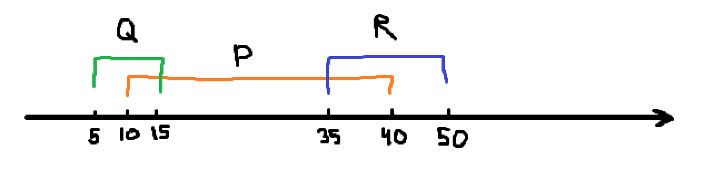
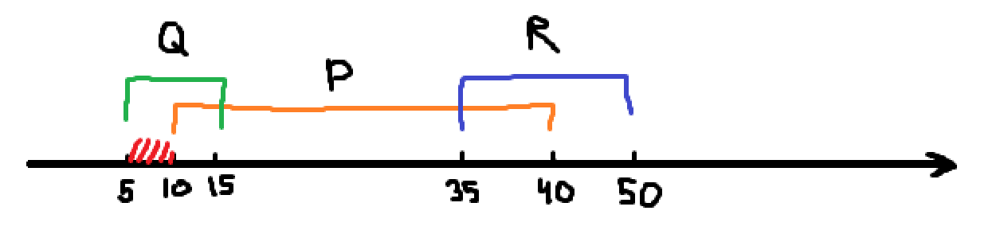

#ИНФОРМАТИКА
Проклятое A

[подробнее про логические операции](Вспомогательные%20моменты.md#Логические%20операции)

## Тип 1 (Отрезки)

### Задание
На числовой прямой даны три отрезка: _P_  = \[10, 40], _Q_  =  \[5, 15] и R  =  \[35, 50]. Какова наименьшая возможная длина промежутка _A_, что формула

`((x ∈ А) ∨ (x ∈ P)) ∨ ((x ∈ Q) → (x ∈ R))`

тождественно истинна, то есть принимает значение 1 при любом значении переменной _х_.

### Ручное решение
1. Для дальнейшей работы представим `x ∈ N` как `N`. Получиться что-то такое: 
   `(A ∨ P) ∨ (Q → R)`
2. Далее раскроем `A → B` как `¬A ∨ B`. И уберём скобки, чтобы не мешали *(все логические операции у нас `или`, поэтому можем просто убрать эти скобки)* 
   `A ∨ P ∨ ¬Q ∨ R`
3. Если представить нашу формулу как выражение.
   `A = ¬(P ∨ ¬Q ∨ R)` => `A = ¬P ∧ Q ∧ ¬R`
4. Отобразим отрезки на числовой прямой
   
5. Покажем на ней нашу формулу
   
6. Размер отрезка и будет являться ответом на задание `10 - 5 = 5`

### Решение программой
1. Задумка такая, будем записывать в массив все числа для `x`, которые выдадут `False` в формуле. Начнём с цикла, пустого массива и записи известных нам массивов
   ```python
   A = [] # Наш будущий массив A
   Q = list(range(5, 16)) # Наш массив Q
   P = list(range(10, 41)) # Наш массив P
   R = list(range(35, 51)) # Наш массив R
   
   for x in range(100): # Цикл чисел x; Число 100 поставлено как предел, если в вашей задаче с числом 100 не вывело ничего, то попробуйте поставить число побольше
   ```
2. Запихнём формулу в условие и будем ловить моменты, где наше условие будет равно `False` и для этого заменим `(x ∈ А)` на `False`
   ```python
   A = []
   Q = ...
   P = ...
   R = ...
   
   for x in ...:
       if not((False or (x in P) ) or ( (x in Q) <= (x in R) )):
   ```
3. Теперь все числа, которые проходят условие будем добавлять в массив `A` и выводить массив `A` и его размер
   ```python
   ...
   
   for x in ...:
       if ...:
           A.append(x) # Добавляем x в массив A
    
   print(*A) # Выводим массив "красивенько"
   print(len(A)) # Выводим длинну массива
   ```
   4. Получается примерно такой вывод
   ```stacktrace
   5 6 7 8 9 # Массив
   5 # Его длинна
   ```
   5. Проверяем что числа в массиве - это последовательность чисел, а не две разорванные последовательности. Такого у нас нет, поэтому `5` (длинна) будет ответом.
#### Полный код
```python
A = [] # Наш будущий массив A

Q = list(range(5, 16)) # Наш массив Q
P = list(range(10, 41)) # Наш массив P
R = list(range(35, 51)) # Наш массив R

for x in range(100): # Цикл чисел x; Число 100 поставлено как предел, если в вашей задаче с числом 100 не вывело ничего, то попробуйте поставить число побольше
    if not((False or (x in P) ) or ( (x in Q) <= (x in R) )): # Условие
        A.append(x) # Добавляем x в массив A

print(*A) # Выводим массив "красивенько"
print(len(A)) # Выводим длинну массива
```

Ответ `5`!

## Тип 2 (поразрядная конъюнкция)

### Задание
Обозначим через _m&n_ поразрядную конъюнкцию неотрицательных целых чисел _m_ и _n_. _Например,_ 14&5  =  11102&01012  =  01002  =  4. Для какого наименьшего неотрицательного целого числа _А_ формула

`(x&6280 > 0 ∨ x&3394 > 0) → (x&10828 = 0 → x&A > 0)`

тождественно истинна (т. е. принимает значение 1 при любом неотрицательном целом значении переменной _х_)?

### Решение
1. Для начала создадим цикл для перебора всех чисел для `A`, с помощью бесконечного цикла
   ```python
    A = 0 # Будущее число A
    
    while True: # Бесконечный цикл для перебора возможных вариантов
	    A += 1 # Увеличиваем значение числа A
   ```
2. Пропишем условие, где проверим, что при значениях `x` в неком диапазоне, значение выражения всегда будет `True`. Для этого будем использовать [генераторы](Python%20фишки.md#Генераторы) и [all](Функции.md#ALL)
   ```python
   A = ...
   
   while True:
       if all(((x&6280 > 0) or (x&3394 > 0)) <= ((x&10828 == 0) <= (x&A > 0)) for x in range(100000)): # Условие что условие равно 1 при возможных значениях x; диапазон желательно брать не много и не мало, чтобы программа не работала 1000 лет и чтобы оно не было слишком мелким, желаю просто взять например 100000, прогнать программу, поставить число в 10 раз больше и если ответ тот же, то ответ скорее всего будет верен
       
       A += 1
   ```
3. Наконец если условие верно, то будем выводить число `A` и ломать цикл
   ```python
   A = ...
   
   while True:
       if ...:
           print(A) # Выводим A
           break # Сразу ломаем, нам нужно самое минимальное значение  
           
       A += 1
   ```

Получаем ответ `5506`!
### Полный код
```python
A = 0 # Будущее число A

while True: # Бесконечный цикл для перебора возможных вариантов
    if all(((x&6280 > 0) or (x&3394 > 0)) <= ((x&10828 == 0) <= (x&A > 0)) for x in range(1000000)): # Условие что условие равно 1 при возможных значениях x; диапазон желательно брать не много и не мало, чтобы программа не работала 1000 лет и чтобы оно не было слишком мелким, желаю просто взять например 100000, прогнать программу, поставить число в 10 раз больше и если ответ тот же, то ответ скорее всего будет верен
        print(A) # Выводим A
        break # Сразу ломаем, нам нужно самое минимальное значение

    A += 1 # Увеличиваем значение числа A
```


## Тип 3 (Число A с условием)

### Задание
Для какого наименьшего целого неотрицательного числа _А_ выражение

`(x + 2y < A) ∨ (y > x) ∨ (x > 30)`

тождественно истинно, то есть принимает значение 1 при любых целых неотрицательных _x_ и _y_?

### Решение
1. Для начала создадим цикл для перебора всех чисел для `A`, с помощью бесконечного цикла
   ```python
    A = 0 # Будущее число A
    
    while True: # Бесконечный цикл для перебора возможных вариантов
	    A += 1 # Увеличиваем значение числа A
   ```
2. Пропишем условие, где проверим, что при значениях `x` в неком диапазоне, значение выражения всегда будет `True`. Для этого будем использовать [генераторы](Python%20фишки.md#Генераторы) и [all](Функции.md#ALL)
   ```python
   A = ...
   
   while True:
       if all(((x + 2 * y < A) or (y > x) or (x > 30)) for x in range(500) for y in range(500)): # Условие что условие равно 1 при возможных значениях x
       
       A += 1
   ```
3. Наконец если условие верно, то будем выводить число `A` и ломать цикл
   ```python
   A = ...
   
   while True:
       if ...:
           print(A) # Выводим A
           break # Сразу ломаем, нам нужно самое минимальное значение
       A += 1
   ```

Получаем ответ `91`!
### Полный код
```python
A = 0 # Будущее число A

while True: # Бесконечный цикл для перебора возможных вариантов
    if all(((x + 2 * y < A) or (y > x) or (x > 30)) for x in range(500) for y in range(500)): # Условие что условие равно 1 при возможных значениях x
        print(A) # Выводим A
        break # Сразу ломаем, нам нужно самое минимальное значение

    A += 1 # Увеличиваем значение числа A
```

## Тип 4 (ДЕЛ)

### Задание
Обозначим через **ДЕЛ(_n_, _m_)** утверждение «натуральное число _n_ делится без остатка на натуральное число _m_».

Для какого наибольшего натурального числа _А_ формула

`ДЕЛ(70, A) ∧ (ДЕЛ(x, 28) → (¬ДЕЛ(x, А) → ¬ДЕЛ(x, 21)))`

тождественно истинна (то есть принимает значение 1 при любом натуральном значении переменной _x_)?

### Решение
1. Для начала создадим цикл для перебора всех чисел для `A` начиная с 1 *(на 0 делить нельзя)*. И создадим массив для хранения всевозможных значений `A`
   ```python
    N = [] # Все числа, которые подходят под A
    
    for A in range(1, 1000): # Бесконечный цикл для перебора возможных вариантов
   ```
2. Пропишем условие, где проверим, что при значениях `x` в неком диапазоне, значение выражения всегда будет `True`. Для этого будем использовать [генераторы](Python%20фишки.md#Генераторы) и [all](Функции.md#ALL)
   ```python
   N = []

   for A in ...:
       if all(((70 % A == 0) and ((x % 28 == 0) <= ((x % A != 0) <= (x % 21 != 0)))) for x in range(1000)): # Условие что условие равно 1 при возможных значениях x
   ```
3. Наконец если условие верно, то будем добавлять число `A` в массив возможных чисел и выведем максимальное
   ```python
   N = []

   for A in ...:
       if ...:
           N.append(A) # Добавлям число в массив подходящих чисел

   print(max(N)) # Выводим максимально возможное
   ```

Получаем ответ `14`!

### Полный код
```python
N = [] # Все числа, которые подходят под A

for A in range(1, 1000): # Бесконечный цикл для перебора возможных вариантов
    if all(((70 % A == 0) and ((x % 28 == 0) <= ((x % A != 0) <= (x % 21 != 0)))) for x in range(1000)): # Условие что условие равно 1 при возможных значениях x
        N.append(A) # Добавлям число в массив подходящих чисел

print(max(N)) # Выводим максимально возможное
```

