#ИНФОРМАТИКА
Параллельные вычислительные процессы

## Тип 1 (Двигаем процессы)

### Задание
110. **В файле 22-110.xls** содержится информация о совокупности N вычислительных процессов, которые могут выполняться параллельно или последовательно... (Условие совпадает с условием задачи из демо-варианта 2024 года). Определите максимальную продолжительность отрезка времени (в мс), в течение которого возможно одновременное выполнение максимального количества процессов, при условии, что все независимые друг от друга процессы могут выполняться параллельно, а время окончания работы всех процессов минимально.
![[22-110.xls]]
### Решение
В файле Exel находятся данные такого формата:

| ID процесса B | Время выполнения процесса B (мс) | ID процесса(ов) A |
| :-----------: | :------------------------------: | :---------------: |
|      101      |                14                |         0         |
|      102      |                3                 |         0         |
|      103      |                1                 |      101;102      |
|      104      |                11                |        102        |
|      105      |                13                |        103        |
|      106      |                5                 |        103        |
|      107      |                2                 |        106        |
|      108      |                1                 |      105;107      |
|      109      |                2                 |        108        |
|      110      |                8                 |         0         |
|      111      |                16                |        110        |
|      112      |                8                 |        110        |
|      113      |                14                |        112        |

Отличие этого типа задания заключается в формулировке задания: "Определите максимальную продолжительность отрезка времени (в мс), в течение которого возможно одновременное выполнение **максимального количества процессов**"

1. В таблице Exel мы начинаем выстраивать продолжительность каждого процесса: 
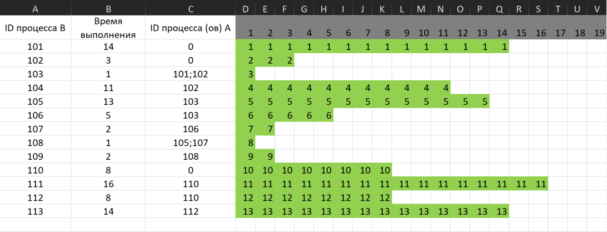
2. Смотрим зависимости процессов и выстаиваем их друг за другом:
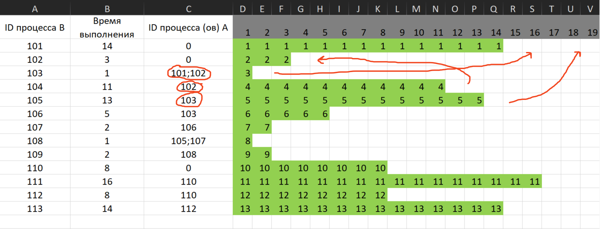
Переносить элементы можно выделив нужные элементы и зажав ЛКМ на самом краю выделенного диапазона, перенести его. После выполненных действия, получаем данную таблицу:
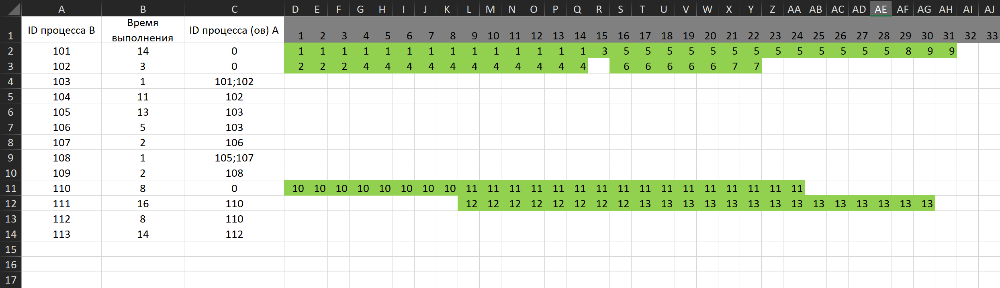
Чаще всего разделение происходит на 2 разных фрагмента, но может быть и больше.
3. Далее перетаскиваем второй фрагмент к первому и соблюдая все зависимости, ищем в каком случае выполняется условие: "Определите **максимальную продолжительность отрезка времени (в мс)**, в течение которого возможно одновременное выполнение **максимального количества процессов**", после чего получаем такую таблицу:
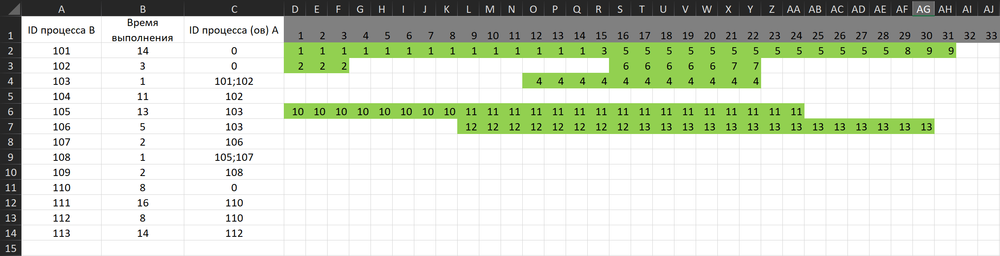
4. Видим, что в параллели максимально могут выполняться только 5 процессов, после чего получаем, что диапазон составляет от 16 мс до 22 мс
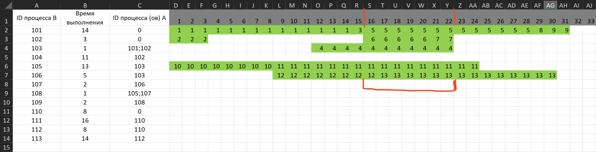
5. Чтобы получить время в мс, требуется из конечного вычесть начальное - 1: (22 - (16-1)) = 17
### Ответ: 17

## Тип 2 (время выполнения совокупности процессов)

### Задание
В файле **22-1.xls** содержится информация о совокупности N вычислительных процессов, которые могут выполняться параллельно или последовательно. Будем говорить, что процесс B зависит от процесса A, если для выполнения процесса B необходимы результаты выполнения процесса A. В этом случае процессы могут выполняться только последовательно. Информация о процессах представлена в файле в виде таблицы. В первом столбце таблицы указан идентификатор процесса (ID), во втором столбце таблицы – время его выполнения в миллисекундах, в третьем столбце перечислены с разделителем «;» ID процессов, от которых зависит данный процесс. Если процесс является независимым, то в таблице указано значение 0. Определите минимальное время, через которое завершится выполнение всей совокупности процессов, при условии, что все независимые друг от друга процессы могут выполняться параллельно.

Типовой пример организации данных в файле:

| ID процесса B | Время выполнения процесса B (мс) | ID процесса(ов) A |
| :---: | :---: | :---: |
| 1 | 4 | 0 |
| 2 | 3 | 0 |
| 3 | 1 | 1; 2 |
| 4 | 7 | 3 |

В данном случае независимые процессы 1 и 2 могут выполняться параллельно, при этом процесс 1 завершится через 4 мс, а процесс 2 – через 3 мс с момента старта. Процесс 3 может начаться только после завершения обоих процессов 1 и 2, то есть, через 4 мс после старта. Он длится 1 мс и закончится через 4 + 1 = 5 мс после старта. Выполнение процесса 4 может начаться только после завершения процесса 3, то есть, через 5 мс. Он длится 7 мс, так что минимальное время завершения всех процессов равно 5 + 7 = 12 мс.
![[22-1.xls]]
### Решение

В файле Exel находятся данные такого формата:

| ID процесса B | Время выполнения процесса B (мс) | ID процесса(ов) A |
| :---: | :---: | :---: |
| 1 | 2 | 0 |
| 2 | 5 | 0 |
| 3 | 1 | 0 |
| 4 | 7 | 1; 2 |
| 5 | 4 | 1; 3 |
| 6 | 4 | 4 |
| 7 | 5 | 5 |
| 8 | 7 | 4; 7 |
| 9 | 15 | 3 |
| 10 | 3 | 6 |
| 11 | 6 | 7; 9 |
| 12 | 4 | 10 |
Отличие этого задания заключается в поиске минимального времени завершения всей совокупности процессов, то есть все процессы начинаются и завершаются за минимальное время, за которое могут.

1. В таблице Exel разделяем зависимости процессов по столбцам:
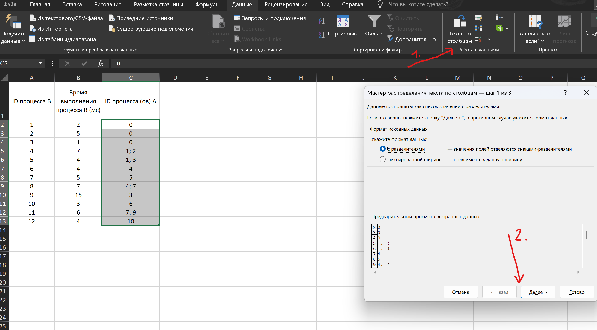
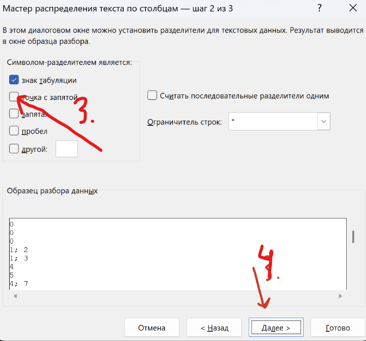 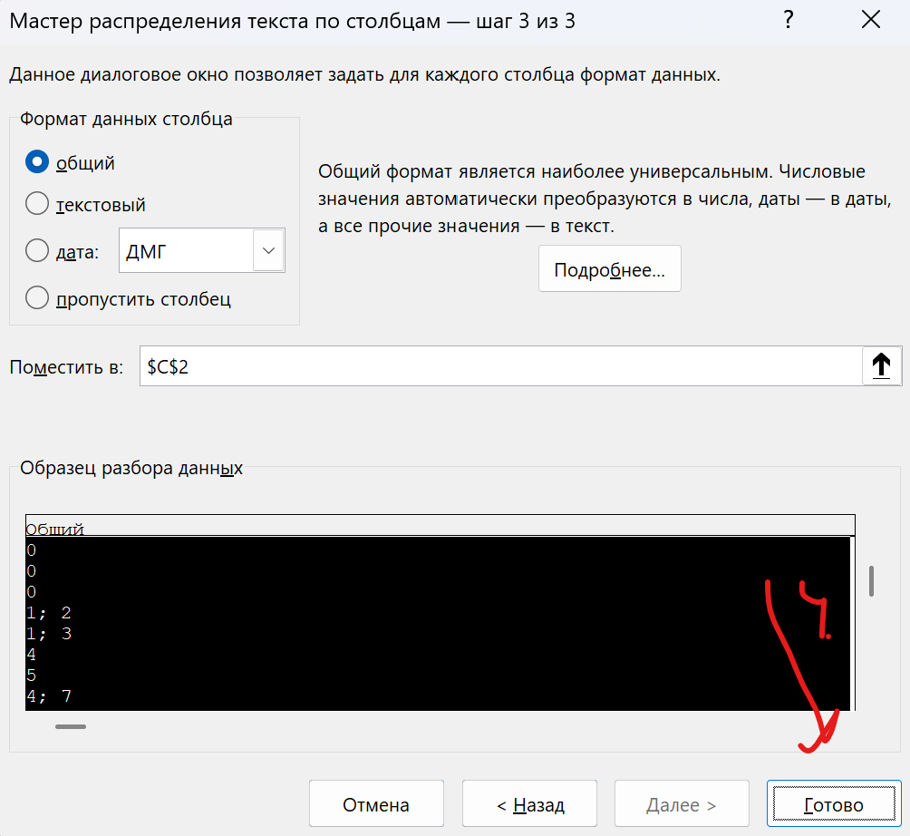
Получаем такую таблицу:
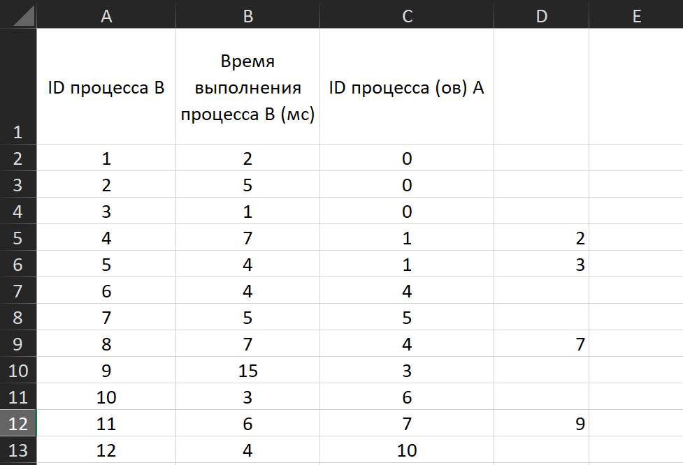
2. Далее справа от зависимых процессов выделяем несколько столбцов, количество выделяемых столбцов вычисляется: количество столбцов зависимостей + 1 (2 + 1), после чего получаем такую таблицу, а также поставить под всем ИД процессов 0, который в следствии станет заглушкой:
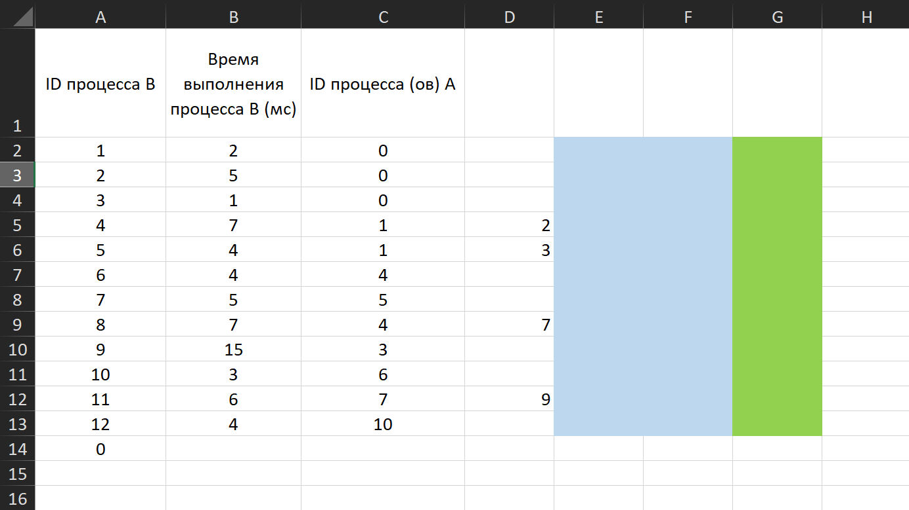

3. В первые два столбца вставляете формулу и протянуть её на весь столбец: =ВПР(C2;$A$1:$G$14;7;0)   в последний столбец вставляете формулу и протягиваете её на весь столбец: =МАКС(E2:F2)+B2   Тогда получаем такую таблицу:
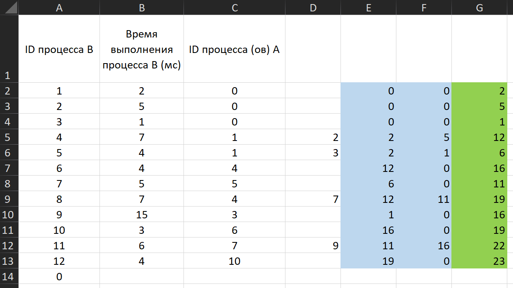
4. Чтобы найти время выполнения всей совокупности, ищите максимальное число из правого столбца и получаете 23
### Ответ: 23
