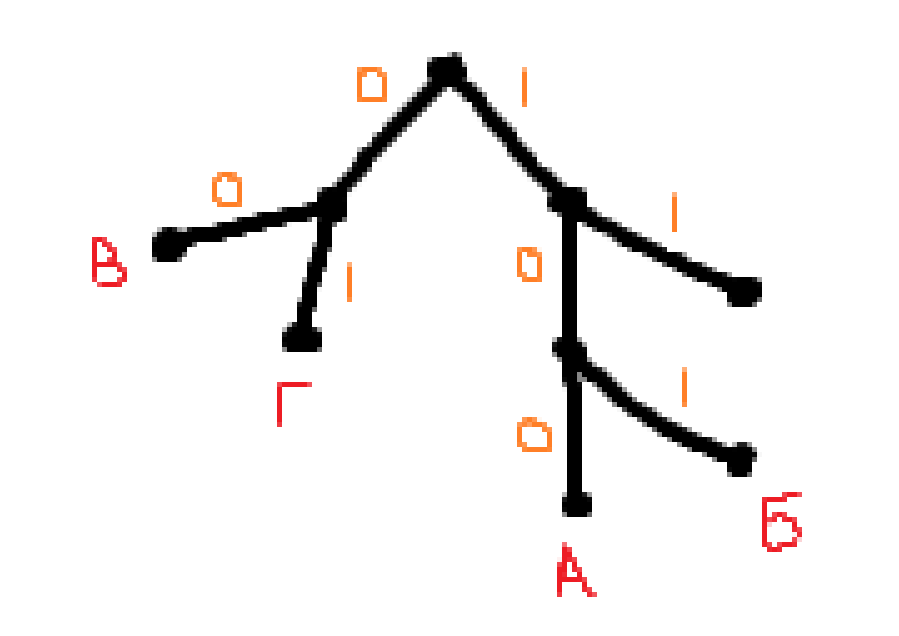
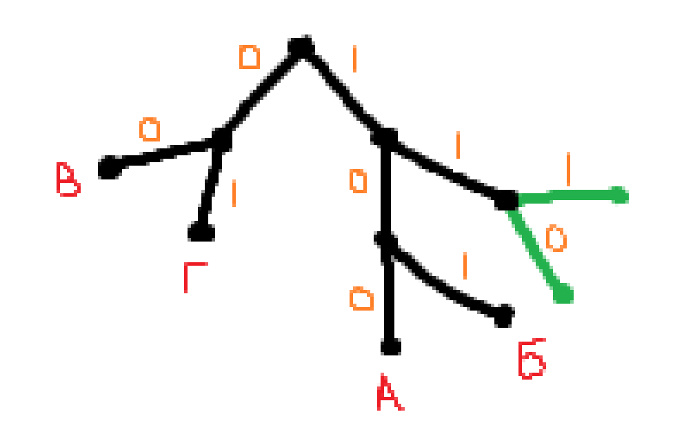

#ИНФОРМАТИКА 
Кодирование слов

*Условие Фано означает, что никакое кодовое слово не является началом другого кодового слова. Это обеспечивает возможность однозначной расшифровки закодированных сообщений.*

## Пример

### Задание
Для кодирования некоторой последовательности, состоящей из букв А, Б, В, Г, Д, Е, решили использовать неравномерный двоичный код, удовлетворяющий условию Фано. Для букв А, Б, В, Г использовали кодовые слова 100, 101, 00, 01 соответственно. Для двух оставшихся букв  — Д и Е  — коды неизвестны.

Укажите кратчайшее кодовое слово для буквы Д, при котором код будет допускать однозначное декодирование. Если таких кодов несколько, укажите код с наименьшим числовым значением.

### Решение
1. Для решения задания будем использовать граф. Расставим на нем буквы, которые нам известны.
   
2. У нас осталось пустое место в пути `11`. Две точки на одном пути расположится не могут, поэтому разветвляем эту точку надвое.
   
3. По условию нужно взять **код с наименьшим числовым значением**, поэтому возьмём как точку `Д` путь `110`

Всё, ответом будет `110`!