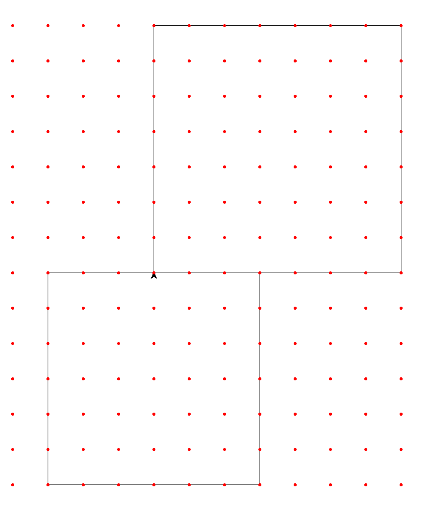
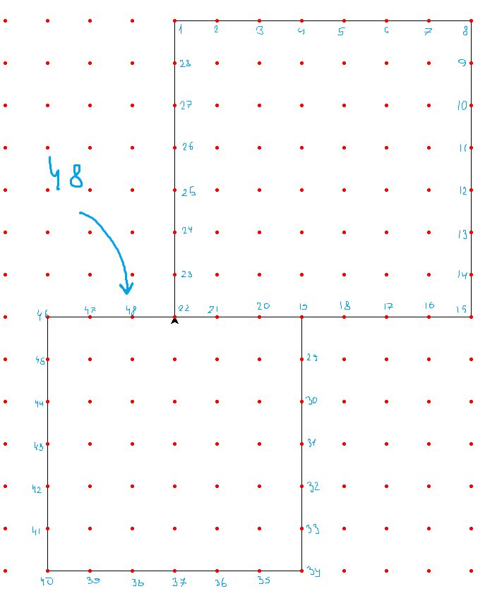

#ИНФОРМАТИКА
Черепашка

## Пример

### Задание
Исполнитель Черепаха передвигается по плоскости и оставляет след в виде линии. Черепаха может выполнять три команды: **Вперёд _n_** (_n_  — число), **Направо _m_** (_m_  — число) и **Налево _m_** (_m_  — число). По команде **Вперёд _n_** Черепаха перемещается вперёд на _n_ единиц. По команде **Направо _m_** Черепаха поворачивается на месте на _m_ градусов по часовой стрелке, при этом соответственно меняется направление дальнейшего движения. По команде **Налево _m_** Черепаха поворачивается на месте на _m_ градусов против часовой стрелки, при этом соответственно меняется направление дальнейшего движения.

В начальный момент Черепаха находится в начале координат и направлена вверх (вдоль положительного направления оси ординат).

Запись **Повтори _k_** **\[Команда1 Команда2 … КомандаS]** означает, что заданная последовательность из _S_ команд повторится _k_ раз.

Черепаха выполнила следующую программу (_x_ в тексте программы  — некоторое натуральное число):

**Повтори 3 \[Вперёд 7 Направо 90]**
**Вперёд 10**
**Повтори 3 \[Налево 90 Вперёд 6]**.

Определите, сколько различных точек с целочисленными координатами будет находиться на линиях, полученных при выполнении данной программы.

### Решение
1. Импортируем библиотеку для рисования
   ```python
   from turtle import * # Библиотека для рисования
   ```
2. По условию надо, чтобы черепашка смотрела вверх при старте, но изначально она смотрит направо, поэтому повернём её. Также ускорим её работу, а то она правда тащится как черепаха, даже на высокой скорости. Не забудем опустить перо для начала рисования.
   ```python
   from turtle import * 

   left(90) # Поворачиваем по условию вверх (изначально черепашка смотрит направо)
   tracer(0, 0) # Ускоряем

   down() # Опускаем кисть для рисования
   ```
3. Для рисования создадим переменную коэффициента увеличения, благодаря которой изображение не будет выглядеть сжатым. Также распишем команды.
   ```python
   from turtle import 

   ...

   k = 50 # Коэффициент увеличения

   for i in range(3): # Первая команда
       forward(7*k) # Вперёд
       right(90) # Направо

   forward(10*k) # Вторая команда: Вперёд

   for i in range(3): # Третья команда
      left(90) # Налево
      forward(6*k) # Вперёд
   ```
4. Также распишем циклы для рисования сетки точек. Не забудем также завршить работу, чтобы окно не закрылось моментально
   ```python
   from turtle import * 
   
   ...
   
   for x in range(-10, 10): # Координата x
       for y in range(-10, 10): # Координата y
           goto(x*k,y*k) # Перемещаем на координату точки
           dot("red") # Устанавливаем точку
           
   done() # Завершаем, но оставляем окно открытым
   ```
5. Запускаем программу и получаем что-то на подобии такого 
   
6. По условию надо получить все точки на линиях, посчитаем их...
   

Получаем заветное число `48`!

### Полный код
```python
from turtle import * # Библиотека для рисования

left(90) # Поворачиваем по условию вверх (изначально черепашка смотрит направо)
tracer(0, 0) # Ускоряем

down() # Опускаем кисть для рисования

k = 50 # Коффициент увеличения

for i in range(3): # Первая команда
    forward(7*k) # Вперёд
    right(90) # Направо

forward(10*k) # Вторая команда: Вперёд

for i in range(3): # Третья команда
    left(90) # Налево
    forward(6*k) # Вперёд

up() # Поднимаем перо, чтобы не оставлять лишние следы

for x in range(-10, 10): # Координата x
    for y in range(-10, 10): # Координата y
        goto(x*k,y*k) # Перемещаем на координату точки
        dot("red") # Устанавливаем точку

done() # Завершаем, но оставляем окно открытым
```