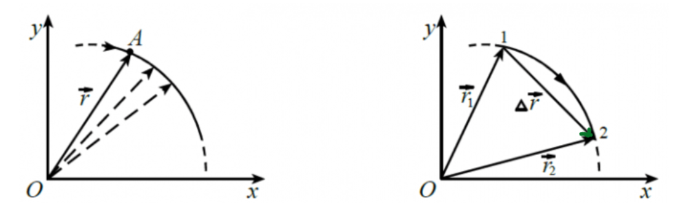
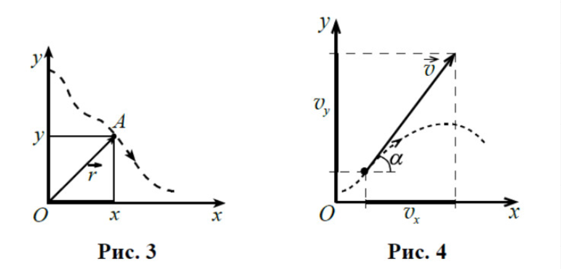

#ФИЗИКА
# Механическое движение, описания его
Начинаем изучение физики традиционно с кинематики. Что такое кинематика? Кинематика, если быть проще, говорит нам о том, как тело перемещается в пространстве: с какой скоростью, с каким временем или ускорением. На ЕГЭ кинематика не самый популярный блок задач, а во второй части тем более. Обычно кинематика идет всегда с динамикой, но в этом году уважаемая Демидова навалила много задач на баллистику, а это, как вы поняли, кинематическое движение. Причем не самое простое. Уйдем прелюдий и перейдем к изучению

Еще стоит рассказать об поступательном движении и вращательном.

Поступательно движение - это движение, когда ваша координата остается постоянной с течением времени. Проще, если ваша координатная плоскость была перпендикулярна земле, то в любой точки пространства в любой момент времени она должна оставаться **постоянной**

МЕХАНИЧЕСКОЕ ДВИЖЕНИЕ

*Механическое движение* - это движение, где тело изменяет свое положение в пространстве относительно ЧЕГО-ЛИБО с течением времени. Чтобы описывать движение, физики придумали разные способы, но пройдемся по тем, которые часто используются

*ВЕКТОРНЫЙ СПОСОБ*

Векторный способ характерен тем, что здесь мы работаем со всем спектром векторов. Надеюсь, что вы векторы помните, но если нет, поговорим об это отдельно. Обычно, для векторного способа добавлят понятие радиус - вектор

*Радиус - вектор* - это вектор из начала координат, который соединяется с материальной точкой, которая та движется по заданной ей траектории.

На картинке точка М. - это начальное положение точки, начало, а вот вектор уже конец. Не трудно, если вы помните, как взаимодействовать с векторами, найти вектор - перемещения. Следовательно, сейчас мы нашли вектор - перемещения. Вектор - перемещение (ΔS) - это вектор, который показывает, можно сказать, смещение от точки старта к финишу.

Формула для подсчёта:
$`\Delta\vec{r} = \vec{r}_2 - \vec{r}_1`$
*(Помните, формула записана в векторном виде!)*

Но векторный подход применяется в ЕГЭ не сильно часто, но именно многие вещи из кинематики расписывают через радиус - вектора, так что мы еще вернемся к ним

*КООРДИНАТА*

Самым популярным методом описания любого движения, который используется и на экзамене является - координатный метод. Главное отличие в том, что мы здесь задаем координаты векторам и высчитываем их. Здесь мы столкнемся с понятием, как проекция оси, упрощающую работу с векторными величинами, делая их скалярными величинами.

Для этого способа важно знать две вещи: как делать проекции и как выбирать направление координат, ведь это упрощает задачи.

Кстати, вы можете видеть, что и радиус - вектор может задаваться координатой.

*В ЧЕМ РАЗНИЦА МЕЖДУ ВЕКТОРНЫМ И КООРДИНАТНЫМ СПОСОБОМ*

Разница есть, а именно в решение! В *векторном* способе вы напрямую работаете с векторами, то бишь с *векторной геометрией*. А в координате вы работаете со скалярными величинами и всеми видами решений задач координатным способом. У каждого вашего вектора есть модуль его (его величина) и его координаты в пространстве

Например, важно запомнить, что модуль любого вектора рассчитывается по формуле: $`\displaystyle V = \sqrt{V_x^2 + V_y^2}`$

*АНАЛитика*

# Относительность механического движения  
# Скорость  
# Ускорение  
# Равномерное движение  
# Прямолинейное равноускоренное движение  
# Свободное падение (ускорение свободного падения)  
# Движение по окружности с постоянной по модулю скоростью. Центростремительное ускорение
