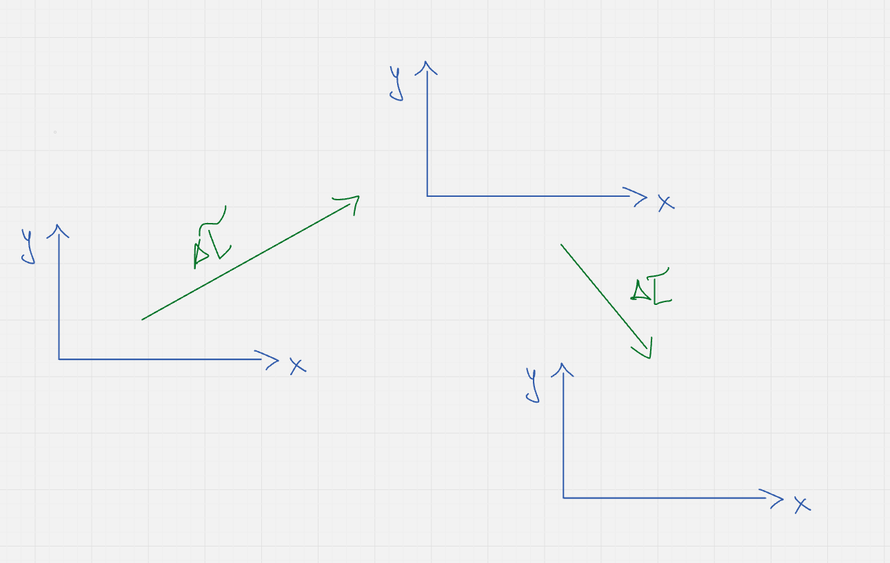
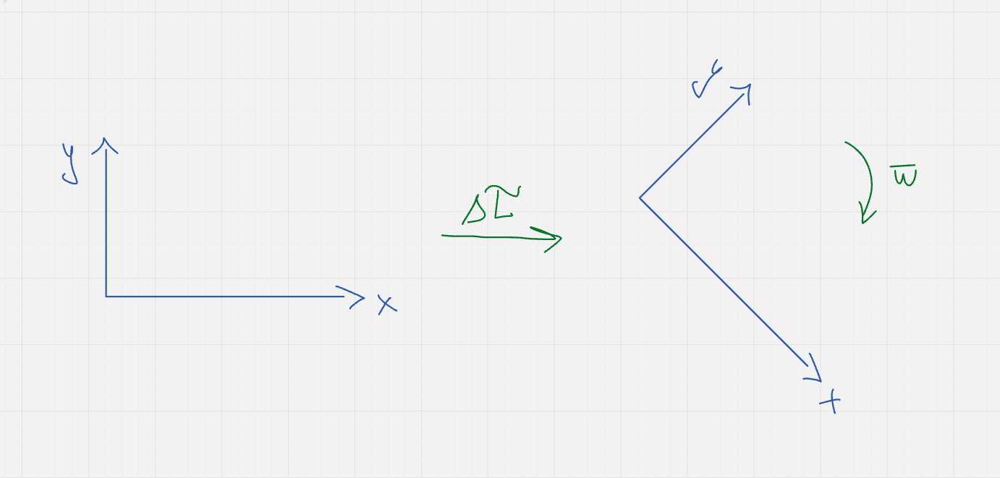

#ФИЗИКА
# Механическое движение, описания его
Начинаем изучение физики традиционно с кинематики. Что такое кинематика? Кинематика, если быть проще, говорит нам о том, как тело перемещается в пространстве: с какой скоростью, с каким временем или ускорением. На ЕГЭ кинематика не самый популярный блок задач, а во второй части тем более. Обычно кинематика идет всегда с динамикой, но в этом году уважаемая Демидова навалила много задач на баллистику, а это, как вы поняли, кинематическое движение. Причем не самое простое. Уйдем прелюдий и перейдем к изучению

Еще стоит рассказать об поступательном движении и вращательном.

Поступательно движение - это движение, когда ваша координата остается постоянной с течением времени. Проще, если ваша координатная плоскость была перпендикулярна земле, то в любой точки пространства в любой момент времени она должна оставаться **постоянной**.

А *вращательное движение* это когда ваша координатная плоскость поворачивается. То есть спустя какое-либо время она не будет параллельна себе, а повернется на условный угол $`\Delta\varphi`$

Как вы видите, координатна плоскость повернулась

В ЕГЭ мы чаще имеем взаимодействия с поступательным движением, но и вращательное проскакивает. 

МЕХАНИЧЕСКОЕ ДВИЖЕНИЕ

*Механическое движение* - это движение, где тело изменяет свое положение в пространстве относительно ЧЕГО-ЛИБО с течением времени. Чтобы описывать движение, физики придумали разные способы, но пройдемся по тем, которые часто используются

*ВЕКТОРНЫЙ СПОСОБ*

Векторный способ характерен тем, что здесь мы работаем со всем спектром векторов. Надеюсь, что вы векторы помните, но если нет, поговорим об это отдельно. Обычно, для векторного способа добавлят понятие радиус - вектор

*Радиус - вектор* - это вектор из начала координат, который соединяется с материальной точкой, которая та движется по заданной ей траектории.

На картинке точка М. - это начальное положение точки, начало, а вот вектор уже конец. Не трудно, если вы помните, как взаимодействовать с векторами, найти вектор - перемещения. Следовательно, сейчас мы нашли вектор - перемещения. Вектор - перемещение (ΔS) - это вектор, который показывает, можно сказать, смещение от точки старта к финишу.

Формула для подсчёта:
$`\Delta\vec{r} = \vec{r}_2 - \vec{r}_1`$
*(Помните, формула записана в векторном виде!)*

Но векторный подход применяется в ЕГЭ не сильно часто, но именно многие вещи из кинематики расписывают через радиус - вектора, так что мы еще вернемся к ним

*КООРДИНАТА*

Самым популярным методом описания любого движения, который используется и на экзамене является - координатный метод. Главное отличие в том, что мы здесь задаем координаты векторам и высчитываем их. Здесь мы столкнемся с понятием, как проекция оси, упрощающую работу с векторными величинами, делая их скалярными величинами.

Для этого способа важно знать две вещи: как делать проекции и как выбирать направление координат, ведь это упрощает задачи.

Кстати, вы можете видеть, что и радиус - вектор может задаваться координатой.

*В ЧЕМ РАЗНИЦА МЕЖДУ ВЕКТОРНЫМ И КООРДИНАТНЫМ СПОСОБОМ*

Разница есть, а именно в решение! В *векторном* способе вы напрямую работаете с векторами, то бишь с *векторной геометрией*. А в координате вы работаете со скалярными величинами и всеми видами решений задач координатным способом. У каждого вашего вектора есть модуль его (его величина) и его координаты в пространстве

Например, важно запомнить, что модуль любого вектора рассчитывается по формуле: $`\displaystyle V = \sqrt{V_x^2 + V_y^2}`$

*АНАЛитика*

У аналитики нет такого четкого определения, но часто это, так сказать, завязано на том, чтобы и вектора не расписывать, и координатами не парится. По сути это чистая алгебра. Например, 11 (в бывшем 10 задача) в ЕГЭ по профмату пример аналитического решения кинематических задач.

Но метод не универсален этот. Но из аналитического метода мы познакомимся с понятием **СРЕДНЕЙ СКОРОСТИ**

Формула средней скорости: $`\displaystyle V_{ср} = \frac{\sum S_i}{t_{общ}}`$

Словами: *Средняя скорость - это отношение суммы всех пройденных участков пути ко всему времени их прохождения*

Но важно учитывать, что есть оказывается ***два*** вида средней скорости. Разберем:

Средняя путевая скорость - это отношение суммы **ВСЕХ РАССТОЯНИЙ** к общему времени. То есть простая, обычная скалярная величина S

Средняя скорость перемещения - это отношение суммы **МОДУЛЕЙ ВЕКТОРОВ ПЕРЕМЕЩЕНИЯ** к общему времени. Видите! *"Перемещение"*, а не расстояния! 

Всегда читайте условия задач вниманительнее, ведь обычно на таком ловят!

*ЧТО БУДЕМ МЫ ИСПОЛЬЗОВАТЬ?*

В ЕГЭ мы будем использовать так сказать *гибриды*. Чуточку от векторного (например в относительном движении), чуточку от координат (например в баллистике) и чуточку аналитики (в сложных задачах на суммирование или в 11 задаче ЕГЭ по профмату)

*ГЛОССАРИЙ ФОРМУЛ*

*Перемещение* (ΔS) - $`\Delta\vec{r} = \vec{r}_2 - \vec{r}_1`$

*Модуль вектора в координате* -  $`\displaystyle V = \sqrt{V_x^2 + V_y^2}`$

*Средняя скорость* - $`\displaystyle V_{ср} = \frac{\sum S_i}{t_{общ}}`$

*ДЛЯ СДВГшников*

1. Кинематика изучает, как тело перемещается в пространстве: его скорость, время и ускорение, но не причины движения.

2. Движение бывает поступательным — связанная с телом координатная плоскость не поворачивается, и вращательным — плоскость поворачивается на некоторый угол.

3. Механическое движение — это изменение положения тела в пространстве относительно чего-либо с течением времени.

4. Для описания движения используют разные способы: векторный, координатный и аналитический.

5. В векторном способе работают напрямую с векторами; ключевое понятие — радиус-вектор, идущий из начала координат к движущейся точке.

6. Вектор перемещения показывает смещение от начального положения к конечному; это не то же самое, что пройденный путь.

7. В координатном способе задают координаты векторов и используют проекции на оси, что позволяет переходить от векторных величин к скалярным.

8. Разница способов — в решении: векторный способ опирается на векторную геометрию, координатный — на работу с координатами и проекциями; у вектора важно различать его модуль и координаты.

9. Аналитический способ близок к чистой алгебре: он позволяет решать кинематические задачи без подробного расписывания векторов и координат.

10. Нужно различать среднюю путевую скорость — по всем пройденным расстояниям — и среднюю скорость перемещения — по модулям векторов перемещения; в задачах на это часто ловят.

# Равномерное движение
# Задачи 1
# Равноускоренное движение
# Задачи 2
# Относительное движение
# Задачи 3
# Движение по окружности с постоянной по модулю скоростью. Центростремительное ускорение
# Задачи 4
# Баллистика
# Факультатив: Векторные треугольник в баллистике
# Задачи 5
# Глоссарий формул
